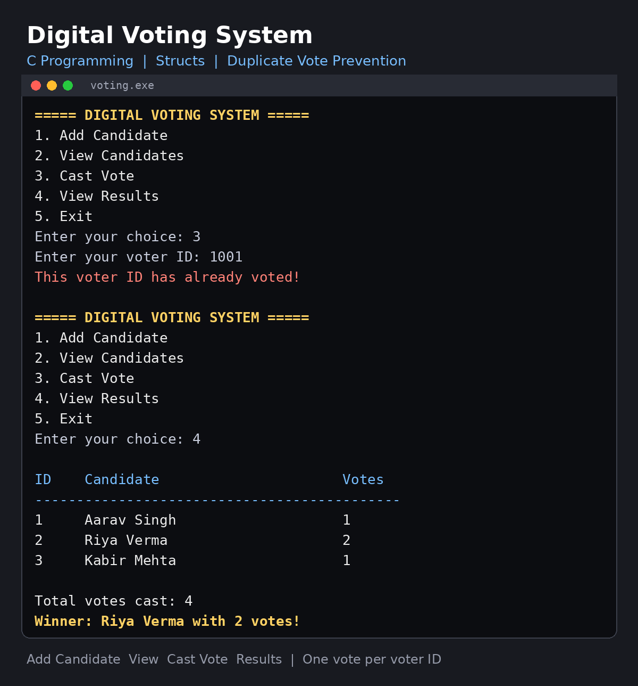

# Digital Voting System (C)



A menu-driven console application in C that simulates a simple
election: add candidates, let voters cast one vote each, and
declare the result.

## Features
- Add candidates (up to 10)
- View the candidate list
- Cast a vote using a voter ID
- Each voter ID can vote only once
- Invalid candidate IDs are rejected and the vote is not counted
- Results table with total votes cast
- Detects a clear winner, a tie, or "no votes cast yet"

## Concepts Used
- Structures (`struct`) and arrays of structures
- Global arrays for tracking voters
- Linear search for duplicate-vote checking
- Functions, loops, `switch-case`
- Input handling with `scanf`

## How to Run
```
gcc digital_voting_system.c -o voting
./voting
```
(Windows: `voting.exe`)

## Limitations
- Data is stored in memory only, so results are lost when the program exits
- Maximum 10 candidates and 100 voters
- No admin login, anyone can add candidates or view results
- Voter ID is not verified (this is a simulation)

## Future Improvements
- Admin password for adding candidates and viewing results
- Save votes to a file
- Validate voter IDs against a registered voter list
- Hide results until voting is closed
